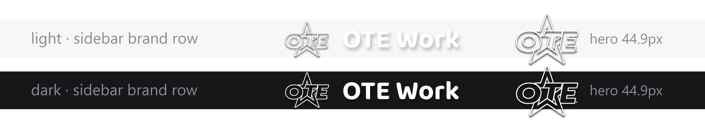

# OTE Work

**OTE Work** 是给 [DeepSeek Harness](https://harness.deepseek.com)（DSH）Web 外壳做的一套改装插件集：
把官方外壳重新上品牌、把输入框和侧栏补成想要的样子——而且**不改动 DSH 任何一个已发布的文件**。

每个插件只占用官方公开的席位（slot）、bundle 补丁或已鉴权的 `/api` 通道，所以移除配置后，
官方外观与行为会原样回来。这不是补丁包，也不是 DSH 的分支。

> 本仓库只包含插件源代码，**不包含 DeepSeek Harness 本体**：没有二进制、没有 `app.asar`、
> 没有 `@deepseek-ai/*` 包。DSH 是 DeepSeek 的产品，本项目与 DeepSeek 无隶属或背书关系。



## 插件

| 插件 | 作用 |
| --- | --- |
| [`dsh-ote-brand`](plugins/dsh-ote-brand/README.md) | **品牌皮肤**：占用侧栏品牌席位与首屏 hero 品牌席位，替换官方鲸鱼标、字标与首屏标语，并隐藏「预览版」角标。以优先级 `-1` 遮蔽官方席位，官方品牌行未被禁用，删掉配置即完全还原。 |
| [`dsh-plus-menu`](plugins/dsh-plus-menu/README.md) | **输入框 `+` 菜单升级**：点加号是一个两级目录（技能 / MCP / 命令），可下钻、可在分类内过滤，**点开加号后直接打字就能搜**。 |
| [`dsh-token-hud`](plugins/dsh-token-hud/README.md) | **侧栏 token 计量卡片**：累计用量、今日用量与缓存命中率，从会话投影缓存聚合而来。 |
| [`dsh-session-bridge`](plugins/dsh-session-bridge/README.md) | **跨 Agent 会话桥**：把一个 DSH 会话经已鉴权的 `/api` 通道暴露给另一个 Agent（Codex、Trae…），提供发现文档、transcript、实时状态与一键复制的交接提示词。 |
| [`dsh-element-picker`](plugins/dsh-element-picker/README.md) | **元素引用**：在内置浏览器预览里点选 UI 元素，一条精确的源码引用就落到输入框里。 |
| [`dsh-governor-mode`](plugins/dsh-governor-mode/README.md) | **总督模式**：DSH 的默认且唯一工作模式——官方右侧栏的「总督」标签页面板（与浏览器 / 文档 / 编辑器并列切换；顶部总督节点 + 最多 8 个手下的 12×12 手绘像素人 + 状态呼吸光晕 + 直角走线 / 数据光流 + 选择题卡 + git 同步灯 + 输入井）；一级栏工作区行换成总督头像，点行按绑定打开总督会话（老工作区自动新建总督并接管既有会话，超 8 停旧），宿主半 `/api/governor` 十三路由控制平面供总督会话用 bash curl 驱动，手下完成任务向总督交简报、忙碌时派单走原生待发区，新建工作区即建总督，视觉照搬总督面板设计稿。 |
| `dsh-picker-probe` | **诊断台**：开发 `dsh-element-picker` 时用来经真实 webview 桥驱动 picker 的一次性诊断插件，保留仅供复现。 |

## 仓库结构

```
plugins/
├── dsh-ote-brand/        品牌皮肤（含生成用工具、字体与预览图）
├── dsh-plus-menu/        输入框 + 菜单
├── dsh-token-hud/        侧栏 token 计量
├── dsh-session-bridge/   跨 Agent 会话桥
├── dsh-element-picker/   预览内元素拾取
├── dsh-governor-mode/    总督模式（v2：官方右侧栏「总督」标签页 + /api/governor 控制平面）
└── dsh-picker-probe/     拾取器的诊断台
tools/
├── install.mjs           一键安装 / 卸载（随安装包下发，离线可用）
├── package-plugins.mjs   打手工包：导已提交内容 + 安装脚本 → dist/*.zip
├── build-installers.mjs  打正式安装包 → dist/*.pkg（macOS）、dist/*.exe（Windows）
├── lib/stage.mjs         打包共享：从 git 已提交内容导载荷 + 版本号
└── installer/            安装器定义
    ├── nsis/OteWork.nsi          Windows 向导（NSIS Modern UI 2）
    ├── mac/scripts/postinstall   mac 安装收尾（以登录用户身份写 DSH 配置）
    └── branding/make.py          NSIS 界面素材：图标 / 页眉 / 横幅帧 / 闪屏（Pillow）
```

每个插件目录都是一个可独立挂载的 DSH 插件包：`package.json` 声明包名，
`cordis.patch.yml` 描述要插进 profile 的那一行，`lib/` 是实际运行的代码，
`tests/` 是离线自测台。

## 安装包

正式发布用平台原生安装器，双击即装、带安装界面：

```sh
node tools/build-installers.mjs             # → dist/OteWork-1.0.0-macOS.pkg（整机：应用本体 + 插件）
node tools/build-installers.mjs --plugins   # → dist/OteWork-1.0.0-macOS-plugins.pkg（只含插件）
node tools/build-installers.mjs --win       # → dist/OteWork-Setup-1.0.0.exe（插件，Windows）
```

- **macOS `.pkg`（整机）**：走系统默认安装器界面（介绍 / 目的宗卷 / 安装 / 摘要），不做自定义皮肤。
  一次装两样：`/Applications/DeepSeek Harness.app`（官方成品，签名与公证原样保留）+ 
  `/usr/local/share/OteWork`（OteWork 插件集）。收尾脚本以当前登录用户的身份把插件写进 DSH profile；
  全新机器上它还顺手立好 desktop profile 骨架，插件第一次打开应用就位，用户不必进终端。
  应用来源：`--app-path` → 本机 `/Applications` → 官方发布通道下载（进 `~/.ote-build/cache`）。
- **Windows `.exe`**：NSIS 向导（开场闪屏 + 逐帧横幅动画 + 欢迎 / 许可 / 目录 / 进度 / 完成五页），
  装到 `%LOCALAPPDATA%\OteWork`，不申请管理员，安装过程中调用随包 `install.mjs` 写 DSH profile。
  整机版留待后续。

组件包的载荷同源（`tools/lib/stage.mjs` 从 git 已提交内容导出），装进 DSH 的动作都交给同一份
`tools/install.mjs`（`--seed-desktop` 立 profile 骨架，`--uninstall` 还原），卸载也走同一份。
版本号在 `tools/lib/stage.mjs` 的 `VERSION` 里，改一处所有包同时变。

Windows 侧需要 `makensis`。macOS 上打 Windows 包可下载 [electron-builder-binaries](https://github.com/electron-userland/electron-builder-binaries/releases)
的 `nsis-3.0.4.1.7z`，解压后指定路径：

```sh
NSISDIR=<解压目录> OTE_MAKENSIS=<解压目录>/mac/makensis node tools/build-installers.mjs --win
```

NSIS 界面素材（图标、页眉图、横幅动画帧、闪屏）由 `tools/installer/branding/make.py` 生成，
需要 `pillow`；重跑一次即可整套重出。

不想用安装器、想手工放插件时：

```sh
node tools/package-plugins.mjs   # → dist/OteWork-plugins-<提交>-<日期>.zip
```

包里是 `git archive` 导出的已提交内容（工作区未提交的改动不进包）+ `install.mjs`
+ 双击入口（`install.command` / `install.cmd`）+ `INSTALL.md`。安装脚本复制插件到
`$DSH_HOME/local-plugins/`，补齐每个 profile 的 `dependencies` 与 `dsh.profile.bundles`，
刷新 `node_modules` 链接——三处缺一插件不生效。可重复运行，覆盖旧版本。

> 安装包本身**未做代码签名**：macOS 首次双击会被 Gatekeeper 拦一次（右键 →「打开」），
> Windows 会弹 SmartScreen（「更多信息」→「仍要运行」）。整机包里那份应用本体**是官方签名 + 公证的**，
> 装完首次打开不会被拦。

## 安装

各插件的 README 有精确的挂载步骤与自测命令；通用流程是：

1. 把 `plugins/<name>` 放到 DSH 能解析的位置——常见做法是复制或 link 到 `$DSH_HOME/local-plugins/<name>`，
   并让 profile 的 `node_modules` 能解析到它。
2. 在 profile 的 `cordis.patch.yml` 里插一行，或用 `dsh plugin add` 走 bundle 通道
   （多数插件自带 `cordis.patch.yml`，**两者选一，不要同时做**）。
3. 浏览器半区（client bundle）是**启动时**校验并下发的，所以装完要**重启 DeepSeek Harness**。

自测（离线，不需要运行中的 DSH）：

```sh
node tests/run.mjs
```

需要 `sharp` / `fontkit` 的构建步骤只存在于 `dsh-ote-brand`，它会从 DSH 安装里自动定位这两个库。

---

## English

**OTE Work** is a customization set of plugins for the **DeepSeek Harness** (DSH) web
shell: it rebrands the shell and extends its composer and sidebar, **without
editing a single shipped DSH file**.

Each plugin only occupies interfaces DSH publishes — brand seats, bundle patches,
the authenticated `/api` channel — so removing its row restores the stock shell
exactly. This is not a patch set and not a DSH fork.

This repository contains **plugin source only**. It redistributes no part of
DeepSeek Harness: no binary, no `app.asar`, no `@deepseek-ai/*` package. DeepSeek
Harness is a product of DeepSeek; this project is not affiliated with, endorsed
by, or sponsored by DeepSeek. See [NOTICE](NOTICE) for third-party attribution.

Install: place `plugins/<name>` where your DSH profile can resolve it, insert the
row from its `cordis.patch.yml` (or add it through the bundle channel with
`dsh plugin add`), then **restart DeepSeek Harness** — client halves are verified
and served at startup.

## License

[MIT](LICENSE) © 2026 OTE Work. Third-party notices: [NOTICE](NOTICE).
